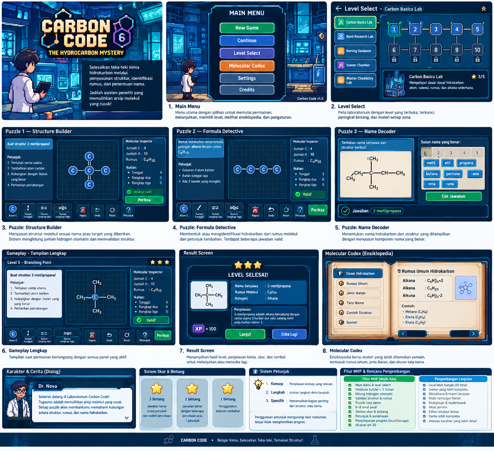
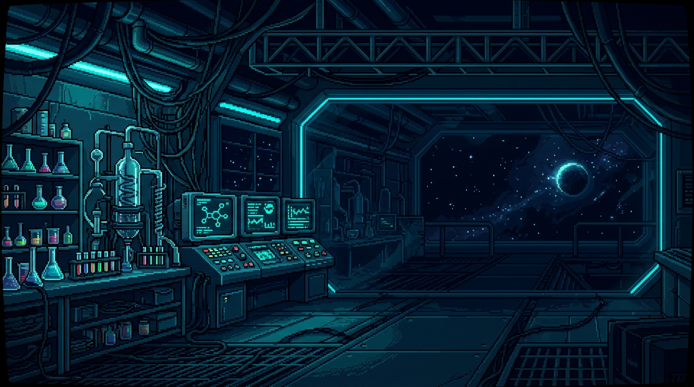

<div align="center">



# CARBON CODE
### The Hydrocarbon Mystery


> **Susun struktur. Baca rumus. Temukan nama.**
> Game puzzle edukasi kimia bertema pixel art untuk memahami hidrokarbon.

[Mainkan Sekarang](#cara-akses) &nbsp;·&nbsp; [Fitur](#fitur-utama) &nbsp;·&nbsp; [Level](#level--zona) &nbsp;·&nbsp; [Kontrol](#kontrol)

</div>

---

## Tentang Game

**Carbon Code: The Hydrocarbon Mystery** adalah game puzzle 2D bergaya pixel art yang mengajak pemain menyusun struktur molekul, memahami rumus kimia, dan menentukan nama hidrokarbon. Berbeda dari kuis biasa, pemain berinteraksi langsung dengan atom dan ikatan di atas papan molekul.

Pemain berperan sebagai asisten laboratorium digital yang bertugas memulihkan arsip molekul rusak di Laboratorium Carbon Code, dibimbing oleh mentor digital **Dr. Nova**. Setiap teka-teki yang selesai akan memulihkan arsip dan membuka area laboratorium berikutnya.

<div align="center">


</div>

> "Selamat datang di Laboratorium Carbon Code! Setiap puzzle membantu kamu memahami hubungan antara struktur, rumus, dan nama senyawa. Tidak ada batas percobaan di sini — eksperimen, periksa, dan pelajari kesalahannya."
> — **Dr. Nova**

**Materi utama:** tata nama dan rumus hidrokarbon (alkana, alkena, alkuna, senyawa bercabang) untuk pelajar SMA.

---

## Fitur Utama

| | Fitur | Deskripsi |
|---|---|---|
| **Molecule Builder** | Papan molekul interaktif | Susun atom karbon pada grid dan hubungkan dengan ikatan, didukung Phaser 3. |
| **Hidrogen Otomatis** | `H = 4 − Σ orde ikatan` | Jumlah hidrogen dan rumus molekul dihitung otomatis dari valensi karbon. |
| **Validasi Cerdas** | Berbasis graf atom | Memeriksa konektivitas, valensi, rumus, kategori senyawa, dan target misi — bukan posisi gambar. |
| **Tiga Jenis Ikatan** | Tunggal, rangkap dua, rangkap tiga | C–C, C=C, dan C≡C dapat dipilih dari action bar. |
| **3 Tipe Puzzle + Combo** | Struktur, rumus, nama | Structure Builder, Formula Detective, Name Decoder, dan Lab Challenge. |
| **Bintang & XP** | 1–3 bintang per level | Penilaian berdasarkan ketepatan dan penggunaan petunjuk. |
| **Petunjuk Bertahap** | 3 tingkat bantuan | Konsep → langkah → bantuan spesifik. |
| **Molecular Codex** | Ensiklopedia mini | Menyimpan materi yang telah ditemukan: rumus umum, jenis ikatan, nama, dan isomer. |
| **Progres Otomatis** | `localStorage` | Progres tersimpan di browser, bisa dilanjutkan kapan saja. |
| **Aksesibel & Responsif** | Skip link, ARIA live, layout adaptif | Tetap nyaman dimainkan di berbagai ukuran jendela desktop. |

---

## Tiga Jenis Puzzle

| Puzzle | Tujuan | Contoh Misi |
|---|---|---|
| **Structure Builder** | Membangun struktur sesuai nama atau target | Susun struktur **2-metilpropana** dari atom karbon. |
| **Formula Detective** | Membentuk molekul dari rumus dan petunjuk | Bentuk alkana rantai terbuka dengan rumus **C₄H₁₀** (semua isomer valid diterima). |
| **Name Decoder** | Menyusun nama dari struktur yang ditampilkan | Tentukan nama struktur dengan 4 karbon dan satu ikatan rangkap → **1-butena**. |
| **Lab Challenge** | Menggabungkan semua mekanik | Bangun **2-metilbutana** (C₅H₁₂), lalu susun namanya. |

Struktur yang sama secara kimia tetap diterima meskipun digambar dengan tata letak berbeda — yang dinilai adalah konektivitas atom dan jenis ikatannya.

---

## Level & Zona

Saat ini tersedia **8 level** dalam **2 zona** yang dapat dimainkan.

| Zona | Status | Fokus |
|---|---|---|
| **Carbon Basics Lab** | Tersedia | Atom, valensi, rumus, dan alkana dasar |
| **Bond Research Lab** | Tersedia | Ikatan tunggal, rangkap dua, dan rangkap tiga |
| **Naming Database** | Segera hadir | Rantai induk, nomor posisi, dan tata nama |
| **Isomer Chamber** | Segera hadir | Percabangan dan isomer struktur |
| **Master Chemistry Lab** | Segera hadir | Kombinasi semua mekanik |

| # | Level | Tipe | Fokus |
|---:|---|---|---|
| 1 | Metana Pertama | Structure Builder | Valensi karbon |
| 2 | Rantai Karbon | Structure Builder | Rantai alkana |
| 3 | Detektor Ikatan | Formula Detective | Ikatan rangkap dua |
| 4 | Struktur Butana | Structure Builder | Rantai utama |
| 5 | Titik Percabangan | Structure Builder | Percabangan & penomoran |
| 6 | Formula Detective | Formula Detective | Isomer struktur |
| 7 | Name Decoder | Name Decoder | Tata nama alkena |
| 8 | Lab Challenge | Combo | Struktur + tata nama |

Level baru terbuka setelah level sebelumnya selesai. Tidak ada sistem energi atau batas percobaan.

---

## Sistem Skor & Petunjuk

<div align="center">

| Bintang | Syarat |
|:---:|---|
| ★★★ | Benar dengan sedikit percobaan, tanpa petunjuk |
| ★★☆ | Benar setelah beberapa percobaan atau 1 petunjuk |
| ★☆☆ | Selesai dengan bantuan tambahan |

</div>

Setiap level menyediakan **tiga tingkat petunjuk**:

1. **Konsep** — menjelaskan aturan kimia yang relevan.
2. **Langkah** — mengarahkan langkah penyelesaian berikutnya.
3. **Spesifik** — menunjukkan bagian struktur atau komponen nama yang perlu diperhatikan.

Petunjuk mengurangi potensi skor maksimal, tetapi tidak pernah menghalangi progres.

---

## Cara Akses

### Prasyarat

- [Node.js](https://nodejs.org/) **20+** dan npm
- Browser modern: Chrome, Edge, Firefox, atau Safari

### Menjalankan di Komputer

```bash
# 1. Clone repositori
git clone https://github.com/atayafahza-ops/HYDROCARBON-PUZZLE.git
cd HYDROCARBON-PUZZLE

# 2. Pasang dependensi
npm install

# 3. Jalankan server pengembangan
npm run dev
```

Buka **http://localhost:5173** di browser. Server berjalan dengan `--host 0.0.0.0`, sehingga juga dapat diakses dari perangkat lain di jaringan yang sama.

### Build Versi Produksi

```bash
npm run build     # hasil build ada di folder dist/
npm run preview   # pratinjau hasil build di http://localhost:4173
```

### Publikasi Online

Belum ada demo publik. Untuk mengaksesnya secara online, build proyek lalu unggah isi folder `dist/` ke static hosting seperti **GitHub Pages**, **Vercel**, atau **Netlify**.

### Progres & Data

Progres permainan disimpan otomatis di `localStorage` browser. Menghapus data situs atau memilih **New Game** di menu utama akan mengulang progres dari awal.

---

## Kontrol

| Aksi | Cara |
|---|---|
| Menempatkan karbon | Klik tombol **Atom C**, lalu klik papan |
| Mengganti jenis ikatan | Pilih **ikatan tunggal**, **rangkap dua**, atau **rangkap tiga** |
| Menghubungkan atom | Klik satu atom, lalu klik atom lain |
| Menghapus atom / ikatan | Pilih elemen, lalu tekan **Hapus** |
| Membatalkan tindakan | Tombol **Undo** |
| Mengulang level | Tombol **Reset** |
| Melihat bantuan | Tombol **Petunjuk** |
| Memeriksa jawaban | Tombol **Periksa** |

---

## Teknologi

| Lapisan | Teknologi |
|---|---|
| Rendering & interaksi molekul | [Phaser 3](https://phaser.io/) |
| Build tool & dev server | [Vite 8](https://vite.dev/) |
| Antarmuka | HTML5, CSS3, JavaScript (ES Modules) |
| Font | [Press Start 2P](https://fontsource.org/fonts/press-start-2p) & [Pixelify Sans](https://fontsource.org/fonts/pixelify-sans) |
| Penyimpanan | Browser `localStorage` |

Logika kimia dipisahkan dari visual: tampilan molekul hanyalah representasi dari graf atom–ikatan yang menjadi sumber data validasi.

---

## Struktur Proyek

```text
HYDROCARBON-PUZZLE/
├── index.html
├── gdd.karbon              # Game Design Document
├── kimia.png               # Banner / cuplikan game
├── public/assets/img/      # Latar laboratorium & karakter
└── src/
    ├── main.js             # Entry point & router layar
    ├── chemistry/          # Validasi, rumus, graf, tata nama
    ├── game/               # MoleculeScene (Phaser) & builder
    ├── data/levels.js      # Data zona, level, target, petunjuk
    ├── screens/            # Menu, level select, gameplay, hasil, codex
    ├── systems/            # Simpan progres, skor, audio, pengaturan
    ├── ui/                 # Dialog, modal, toast, ikon, router
    └── styles/             # Tema pixel art & layout responsif
```

---

## Peta Jalan

- **v1.0 (sekarang)** — MVP: 8 level, 3 tipe puzzle, bintang, petunjuk, codex, progres tersimpan.
- **v1.1** — Level alkana bercabang tambahan, variasi puzzle rumus, tutorial interaktif.
- **v1.2** — Tantangan seluruh isomer, level bonus, statistik pemain.
- **v2.0** — Struktur kompleks, sikloalkana, tantangan harian, cerita lanjutan.

Detail lengkap desain, aturan kimia, dan rencana pengembangan tersedia di [`gdd.karbon`](gdd.karbon).

---

<div align="center">

**CARBON CODE** — Belajar Kimia, Selesaikan Teka-Teki, Temukan Struktur!

Dibuat dengan semangat belajar kimia dan pixel art.

Lisensi [ISC](https://opensource.org/licenses/ISC)

</div>
